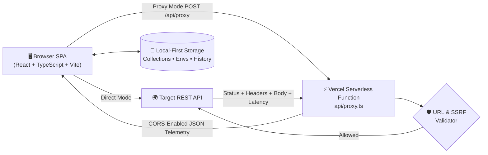

<div align="center">

# ⚡ PulseAPI Studio

### Blazing-Fast, Open-Source Full-Stack API Client & Testing Studio

*A lightweight, privacy-first alternative to heavy desktop API clients — engineered with React, TypeScript, Vite, Tailwind CSS, and a built-in Vercel Serverless CORS Proxy.*

<p>
  
  
  
  
  
</p>

<p>
  <a href="https://github.com/a1n2a3s6/pulse-api-studio/stargazers">
    
  </a>
  <a href="https://github.com/a1n2a3s6/pulse-api-studio/network/members">
    
  </a>
  
</p>

<p>
  <a href="https://pulse-api-studio.vercel.app/"><strong>🚀 Live Demo</strong></a> •
  <a href="#-key-features"><strong>✨ Features</strong></a> •
  <a href="#-system-architecture"><strong>🏗️ Architecture</strong></a> •
  <a href="#-quick-start"><strong>⚡ Quick Start</strong></a> •
  <a href="#-one-click-deploy"><strong>☁️ Deploy</strong></a>
</p>

</div>

---

## 🎯 Why PulseAPI Studio?

Modern API clients have become bloated, require mandatory cloud accounts, and lock basic team workflows behind paywalls. **PulseAPI Studio** gives you a crisp, IDE-grade REST client directly in your browser with **zero sign-up**, **100% local-first storage**, and a **serverless CORS proxy** so real-world endpoints work out of the box.

| Capability | ⚡ PulseAPI Studio | Traditional Desktop Clients |
| :--- | :---: | :---: |
| **Instant Browser Launch (Zero Install)** | ✅ | ❌ |
| **Zero Mandatory Account / Cloud Lock-In** | ✅ | ❌ |
| **Built-In Serverless CORS Proxy** | ✅ | N/A |
| **100% Local-First Privacy (`localStorage`)** | ✅ | ❌ |
| **Multi-Language Code Export (`cURL`, `fetch`, `Axios`, `Python`)** | ✅ | ✅ |
| **Open Source & Free Forever (MIT)** | ✅ | ❌ |

---

## ✨ Key Features

<table>
  <tr>
    <td width="50%" valign="top">
      <h3>🌐 CORS-Free Serverless Proxy</h3>
      <p>Built-in Vercel Serverless Function (<code>/api/proxy.ts</code>) forwards REST requests cleanly with exact upstream latency timing, byte-size telemetry, and SSRF protection against private IPs.</p>
    </td>
    <td width="50%" valign="top">
      <h3>🗂️ Multi-Tab IDE Workspace</h3>
      <p>Open, edit, and test multiple API endpoints simultaneously in browser-like tabs with keyboard-first shortcuts and instant tab switching.</p>
    </td>
  </tr>
  <tr>
    <td width="50%" valign="top">
      <h3>🔐 Complete Auth & Variables</h3>
      <p>Supports Bearer Tokens, API Keys (Header/Query), Basic Auth, and dynamic <code>{{ENV_VAR}}</code> interpolation across Staging and Production environments.</p>
    </td>
    <td width="50%" valign="top">
      <h3>🔍 Rich JSON & Header Inspector</h3>
      <p>Inspect responses with syntax-colored Pretty JSON, collapsible tree view, Raw payload view, full response headers, status badges, and 1-click Copy/Download.</p>
    </td>
  </tr>
  <tr>
    <td width="50%" valign="top">
      <h3>💻 Instant Code Generation</h3>
      <p>Convert any configured request (with resolved environment variables) into production-ready <b>cURL</b>, <b>JavaScript fetch</b>, <b>Axios</b>, or <b>Python requests</b> snippets in one click.</p>
    </td>
    <td width="50%" valign="top">
      <h3>💾 Collections & Workspace Portability</h3>
      <p>Organize endpoints into folders, browse timestamped request history, and export or import your entire workspace as portable JSON backups.</p>
    </td>
  </tr>
</table>

---

## 🏗️ System Architecture

PulseAPI Studio combines a zero-latency React + TypeScript SPA with an optional Vercel Serverless relay to bypass browser CORS restrictions while keeping your collections strictly on your machine.



---

## 📂 Project Structure

```text
pulse-api-studio/
├── api/
│   └── proxy.ts               # Vercel Serverless CORS Proxy & latency telemetry
├── src/
│   ├── types/
│   │   └── api.ts             # Strict TypeScript domain models
│   ├── utils/
│   │   ├── codeGen.ts         # cURL, Fetch, Axios & Python snippet generator
│   │   └── storage.ts         # Local-first persistence & JSON import/export
│   ├── components/
│   │   ├── Sidebar.tsx        # Collections tree, History & Env switcher
│   │   ├── RequestBar.tsx     # Method picker, URL bar, Proxy toggle & Send
│   │   ├── RequestTabs.tsx    # Params, Headers, Auth & JSON Body editor
│   │   ├── ResponsePanel.tsx  # Status, Latency/Size HUD, Pretty/Raw/Headers
│   │   └── CodeModal.tsx      # Multi-language snippet preview & copy modal
│   ├── App.tsx                # Multi-tab workspace & global shortcuts
│   ├── main.tsx
│   └── index.css
├── index.html
├── package.json
├── tsconfig.json
├── vite.config.ts
└── vercel.json

```

---

## ⌨️ Keyboard Shortcuts

| Shortcut | Action |
| --- | --- |
| `Ctrl` / `Cmd` + `Enter` | Send active HTTP request |
| `Ctrl` / `Cmd` + `S` | Save active request to Collection |
| `Ctrl` / `Cmd` + `K` | Focus URL bar / Quick search |

---

## ⚡ Quick Start (Local Development)

```bash
# 1. Clone the repository
git clone [https://github.com/a1n2a3s6/pulse-api-studio.git](https://github.com/a1n2a3s6/pulse-api-studio.git)

# 2. Navigate into the project directory
cd pulse-api-studio

# 3. Install dependencies
npm install

# 4. Start the Vite development server
npm run dev

```

> **Note:** To run the `/api/proxy.ts` serverless function locally alongside Vite, run `npx vercel dev`.

---

## ☁️ One-Click Deploy

Deploy your own instance of **PulseAPI Studio** (Frontend + Serverless CORS Proxy) to Vercel in under 60 seconds with zero configuration:

---

## 🗺️ Roadmap

* [x] Multi-tab REST client with Params, Headers, Auth & JSON Body
* [x] Built-in Vercel Serverless CORS Proxy with latency & payload metrics
* [x] Multi-language code generation (`cURL`, `fetch`, `Axios`, `Python`)
* [ ] GraphQL query & schema introspection support
* [ ] WebSocket & Server-Sent Events (SSE) live stream tester
* [ ] OpenAPI / Swagger 3.0 spec importer

---

## 🤝 Contributing

Contributions, issues, and feature requests are always welcome!

1. Fork the repository
2. Create your feature branch (`git checkout -b feat/amazing-feature`)
3. Commit your changes (`git commit -m "feat: add amazing feature"`)
4. Push to the branch (`git push origin feat/amazing-feature`)
5. Open a Pull Request

---

## 📄 License

Distributed under the **MIT License**. Free to use, modify, and self-host.

---

### 👨‍💻 Author & Connect

Built with passion by **Anas Alhelaly** — *Day 7 of my **365 Projects in 365 Days** GitHub Challenge*

⭐ **If you find PulseAPI Studio useful, consider giving the repo a Star!** ⭐

